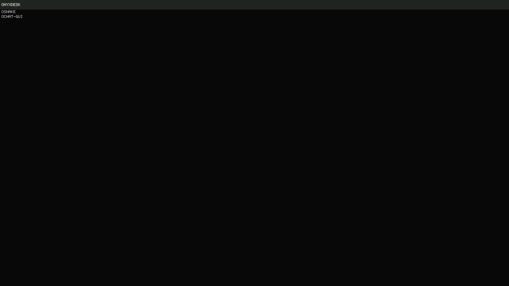

<p align="center">
<pre class="not-prose" style="text-align:center;font-family:monospace;">
    ███████
  ███▒▒▒▒▒███
 ███     ▒▒███ ████████   █████ ████ █████ █████
▒███      ▒███▒▒▒███▒▒▒███ ▒▒███ ▒███ ▒▒███ ▒▒███
▒███      ▒███ ▒███ ▒███  ▒███ ▒███  ▒▒▒█████▒
▒▒███     ███  ▒███ ▒███  ▒███ ▒███   ███▒▒▒███
 ▒▒▒███████▒   ████ █████ ▒▒███████  █████ █████
   ▒▒▒▒▒▒▒    ▒▒▒▒ ▒▒▒▒▒   ▒▒▒▒▒███ ▒▒▒▒▒ ▒▒▒▒▒
                           ███ ▒███
                          ▒▒██████
                           ▒▒▒▒▒▒
      ███████      █████████
    ███▒▒▒▒▒███   ███▒▒▒▒▒███▒
   ███     ▒▒███ ▒███    ▒▒▒
  ▒███      ▒███ ▒▒█████████
  ▒███      ▒███  ▒▒▒▒▒▒▒▒███
  ▒▒███     ███   ███    ▒███
   ▒▒▒███████▒   ▒▒█████████
     ▒▒▒▒▒▒▒      ▒▒▒▒▒▒▒▒▒
</pre>
</p>

<p align="center"><em>Build orchestration, disk image assembly and documentation for Onyx, an operating system for RISC-V written from scratch</em></p>

<p align="center">
  
  
  
  
  
  
</p>

<p align="center">
  
</p>

----

**OnyxOS is an operating system for RISC-V, written from scratch.**
It started as a system for the [OC2R](https://github.com/TumRedSun/OC2R)
Minecraft mod (OpenComputers 2, which emulates RISC-V with Sedna), and it also
boots in QEMU. A Milk-V Duo S port is a goal, not yet verified on hardware.

Everything in the stack is our own code: a monolithic kernel in Rust, a
bootloader in C++, a Rust shell, and a self-hosting C compiler that builds the
userland.

```console
$ bash scripts/bootstrap.sh && bash scripts/build-all.sh && bash scripts/run-qemu.sh
```

Log in as `root` and you get a shell, a TCP/IP stack, FAT32 and OnyxFS v2,
plus Lua, vim and a few more apps built with our own compiler.

This repository is the meta-project. It vendors the other Onyx repositories as
sibling checkouts under `.vent/repos/`, builds all of them, and assembles the
boot disk image and QEMU launch scripts.

## Status

| Area | State |
|------|-------|
| Boot in QEMU `virt` (OpenSBI, OnyxBoot, kernel, init, login) | Works |
| Boot inside OC2R (Sedna) | Works, verified in-game |
| TCP/IP, UDP, DHCP, DNS | Works; HTTP only, no TLS |
| FAT32, OnyxFS v2 (journal, snapshots) | Works |
| Self-hosting compiler | Works (`make selfhost-test`) |
| SMP | Experimental, multi-hart boots are not stable yet |
| Unprivileged user sessions | Unfinished: login does not install uid/gid yet |
| Real single-board hardware (Milk-V Duo S) | Not verified |
| GUI (window manager, compositor), Java runtime | Planned |

----

## Quick Start

```console
$ # 1. Install build dependencies
$ sudo pacman -S cmake base-devel curl libarchive             # Arch
$ sudo apt install cmake build-essential libcurl4-openssl-dev libarchive-dev  # Debian/Ubuntu

$ # 2. Clone every Onyx repository as a sibling checkout
$ bash scripts/bootstrap.sh

$ # 3. Build every component and assemble the boot disk image
$ bash scripts/build-all.sh

$ # 4. Boot it in QEMU
$ bash scripts/run-qemu.sh
```

`scripts/bootstrap.sh` reads repository URLs from `Onyx.vent` and checks out
exact commits from `Onyx.lock.json` into `.vent/repos/`. It needs Python 3 and
Git, nothing else; Vent is not required. Existing dirty or symlinked
repositories are never checked out automatically. `scripts/build-all.sh`
verifies the lock before building and writes artifacts to `.build/`.

Build memory is capped by `scripts/mem-limit.sh` at 6 GiB by default: a
cgroup v2 limit via `systemd-run --user --scope` where user systemd is
available, otherwise `ulimit -v`. Set `ONYX_BUILD_MEM_LIMIT` to change the
cap; `0` or `off` disables it. A runaway rustc or a `make -j` storm then
cannot take the whole machine down.

For local sibling checkouts or symlinks, explicitly opt into development
inputs:

```console
$ ONYX_DEPS_MODE=workspace bash scripts/build-all.sh
$ ONYX_DEPS_MODE=workspace bash scripts/build-oc2r.sh
```

This mode reports revisions and dirty status; it does not claim a locked
build. See [dependency locking](docs/dev/dependencies.md) for release
updates.

----

## Repository Layout

```
OnyxOS/
├── Onyx.vent               # Component source URLs
├── Onyx.lock.json          # Exact component Git revisions
├── .vent/
│   └── repos/               # Sibling checkouts (after bootstrap.sh)
├── scripts/
│   ├── bootstrap.sh         # Clone exact locked component revisions
│   ├── build-all.sh         # Build every component + assemble the disk image
│   ├── build-oc2r.sh        # Build the OC2R flash image
│   ├── check-abi.sh         # Validate coordinated ABI snapshots
│   ├── mem-limit.sh         # Cap build memory (cgroup v2 / ulimit -v)
│   ├── run-qemu.sh          # Boot in QEMU (dev mode or full boot chain)
│   ├── mk-onyxfs-disk.sh    # Build the FAT32 + OnyxFS partitioned disk image
│   ├── qemu-smoke.sh        # Headless boot smoke test
│   └── qemu-interactive-smoke.sh  # Interactive boot smoke test
├── docs/
│   ├── architecture/        # Boot chain, memory layout, privilege rings
│   ├── dev/                 # Building, contributing, roadmap
│   ├── hardware/            # UART, PLIC, CLINT, VirtIO
│   ├── internals/            # Coding style, error handling conventions
│   ├── kernel/               # Process model, memory management, interrupts
│   ├── shell/                 # Shell commands and internals
│   └── lore/                  # Project history and notes
├── Makefile
└── README.md
```

----

## Running QEMU

`scripts/run-qemu.sh` supports two modes:

```console
$ bash scripts/run-qemu.sh boot    # default: full chain via OnyxBoot + a disk image
$ bash scripts/run-qemu.sh dev     # fast dev loop: QEMU loads the kernel ELF directly, no disk image
```

Useful environment variables:

| Variable | Effect |
|----------|--------|
| `QEMU_MEM` | RAM size (default `256M`) |
| `QEMU_EXTRA` | Extra QEMU flags, e.g. `-s -S` for GDB |

SMP is controlled by passing `-smp N` via `QEMU_EXTRA`, or by invoking QEMU
directly. See the
[OnyxKernel README](https://github.com/DivByDiamond/OnyxKernel) for the full
manual command line and its multi-hart caveat: the kernel supports up to
8 harts, but multi-hart boots are still experimental.

----

## Building Components Individually

### OnyxKernel

```console
$ cd .vent/repos/OnyxKernel
$ cargo kbuild    # alias for: cargo build --release -p onyx_kernel --target riscv64gc-unknown-none-elf
```

### OnyxBoot

```console
$ cd .vent/repos/OnyxBoot
$ make -j$(nproc)
```

### OnyxShell

```console
$ cd .vent/repos/OnyxShell
$ bash build.sh
```

### OnyxCompiller

```console
$ cd .vent/repos/OnyxCompiller
$ make            # native Linux binary
$ make onyxcc-onx # cross-compiled .onx for OnyxOS
```

----

## Building a Firmware Image for OC2R

> [OC2R](https://github.com/TumRedSun/OC2R) is a Minecraft (NeoForge) mod
> that adds virtual computers with 64-bit RISC-V emulation. OnyxOS can boot
> directly inside the game.

OC2R downloads a computer's firmware from a GitHub repository using an
`oc2r-firmware.json` manifest at the repository root. The mod reads it,
follows the `image` link, and flashes that image into the virtual machine.

### Manifest format (`oc2r-firmware.json`)

```json
{
  "name": "OnyxOS",
  "version": "0.3.0",
  "layout": "minux",
  "image": "https://github.com/DivByDiamond/OnyxOS/releases/latest/download/onyx-flash.img"
}
```

| Field | Value | Description |
|-------|-------|-------------|
| `name` | `OnyxOS` | Firmware name |
| `version` | e.g. `0.3.0` | Matches the OnyxKernel workspace `Cargo.toml` version |
| `layout` | `minux` | Flash layout scheme (below) |
| `image` | direct link to `onyx-flash.img` | The flat flash image attached to a GitHub Release |

`minux` layout (flash is exactly 15 MB):

| Offset | Size | Contents |
|--------|------|----------|
| `0x000000` | - | `fw_jump.bin` (OpenSBI, from the OC2R mod's `src/main/scripts/firmware_files/`) |
| `0x200000` (2 MB) | - | OnyxKernel image (ELF, built by cargo) |
| up to 15 MB | - | zero-filled |

### Building the image manually

```console
$ # 1. Resolve locked dependencies into .vent/repos/
$ make deps

$ # 2. Build the bootloader and kernel
$ make -C .vent/repos/OnyxBoot
$ cargo build --release -p onyx_kernel --target riscv64gc-unknown-none-elf \
    --manifest-path .vent/repos/OnyxKernel/Cargo.toml

$ # 3. Place a real OpenSBI build at firmware/fw_jump.bin
$ #    (from the OC2R mod: src/main/scripts/firmware_files/fw_jump.bin)

$ # 4. Assemble a 15 MB image using the minux layout
$ dd if=/dev/zero of=onyx-flash.img bs=1M count=15
$ dd if=firmware/fw_jump.bin of=onyx-flash.img conv=notrunc
$ dd if=.vent/repos/OnyxKernel/target/riscv64gc-unknown-none-elf/release/onyx-kernel \
    of=onyx-flash.img bs=1M seek=2 conv=notrunc
```

### Automated builds via GitHub Actions

`.github/workflows/release.yml` runs on every pushed git tag (e.g. `v0.3.0`):

1. Builds every component (`make deps` resolves exact component commits from `Onyx.lock.json`).
2. Assembles `onyx-flash.img` (15 MB, `minux` layout).
3. Creates a GitHub Release and attaches the image.

The manifest's `image` field points at
`/releases/latest/download/onyx-flash.img`, which GitHub resolves to the
newest release's asset automatically.

To produce a working release you need to either:

1. Commit a real `fw_jump.bin` (OpenSBI) at `firmware/fw_jump.bin`, or set the
   repository variable `OC2R_FW_JUMP_URL` (without either, CI builds an image
   with a placeholder that will not boot); and
2. Push a tag such as `v0.3.0`. CI builds and uploads the image.

Every push to `main` also publishes a preview image as a workflow artifact,
without creating a Release.

----

## Userspace Applications

Optional userspace programs live in the
[OnyxApps](https://github.com/DivByDiamond/OnyxApps) monorepo: a text editor,
a system monitor, an HTTP client and more. Each application has its own
`README.md` under `apps/<name>/`. Build with `make` in the OnyxApps
repository root; CI also publishes `build/*.onx` artifacts.

All applications run on top of the kernel's ANSI/VT100 framebuffer
terminal (`fb_term`/`ansi.rs`): SGR colors, cursor positioning, erase
sequences, scroll regions, per-process `termios` via `TCGETS`/`TCSETS`, and
`TIOCGWINSZ` reporting the real framebuffer grid.

----

## Testing

```console
$ bash scripts/qemu-smoke.sh
$ bash scripts/qemu-interactive-smoke.sh
```

`qemu-smoke.sh` boots the full chain headless (OpenSBI, OnyxBoot, FAT32,
kernel, init, login) and waits for the `osh` prompt; `SMOKE_TIMEOUT` sets the
wait in seconds, default 60. `qemu-interactive-smoke.sh` logs in as `root`
with the empty first-boot password, runs `whoami`, `echo`, `ls` and `uname`
in the shell, and fails if the serial log contains an illegal instruction;
`SMOKE_TOTAL` sets its timeout, default 120 seconds. Both scripts require
`.build/onyx-boot.bin` and `.build/onyx-boot-disk.img`, produced by
`scripts/build-all.sh` and `scripts/mk-onyxfs-disk.sh`.

Hardware verification procedures are described in
[OnyxKernel's testing docs](https://github.com/DivByDiamond/OnyxKernel/blob/main/docs/TESTING.md)
and in `scripts/qa/README.md`.

----

## Roadmap and Known Issues

Planned work and open issues are tracked in
[`docs/dev/roadmap.md`](docs/dev/roadmap.md) (project-wide milestones) and
[OnyxKernel's `todo.md`](https://github.com/DivByDiamond/OnyxKernel/blob/main/todo.md)
(kernel-level tracking, including in-progress investigations). Known problems
of the current build are listed in
[`docs/dev/known_issues.md`](docs/dev/known_issues.md).

----

## Ecosystem

| Repository | Role | Language |
|---|---|---|
| [OnyxOS](https://github.com/DivByDiamond/OnyxOS) | Ecosystem: build, disk image, docs | Bash / Python |
| [OnyxKernel](https://github.com/DivByDiamond/OnyxKernel) | RISC-V 64 kernel (Sv39, 3 rings) | Rust |
| [OnyxBoot](https://github.com/DivByDiamond/OnyxBoot) | Bootloader (M-mode, FDT) | C++20 |
| [OnyxShell](https://github.com/DivByDiamond/OnyxShell) | User shell `osh` | Rust |
| [OnyxCompiller](https://github.com/DivByDiamond/OnyxCompiller) | C99 compiler `onyxcc` + linker | C99 |
| [OnyxApps](https://github.com/DivByDiamond/OnyxApps) | Userland applications | C99 |
| [OnyxDesktop](https://github.com/DivByDiamond/OnyxDesktop) | Desktop environment `onyxdesk` | C99 |

What each component contributes to the image:

- **OnyxBoot**: bootloader with FDT, VirtIO, SDHCI, FAT32/ext4, GPT and a boot menu.
- **OnyxKernel**: monolithic kernel with SMP, Sv39 MM, VFS, TCP/IP, OnyxFS v2, FAT32 and a wide syscall ABI.
- **OnyxShell**: `/bin/osh` with built-in commands, tab completion, history, pipes and redirections, globbing, job control.
- **OnyxCompiller**: self-hosting C compiler, C99 to RV64 with `.onx` output, plus `libonyxc`.
- **OnyxApps**: optional userland applications built with OnyxCompiller.
- **OnyxDesktop**: desktop environment `onyxdesk`.
- **OnyxOS** (this repo): build orchestration, docs, disk image assembly.

The dependency structure between the repositories is mapped in
[`docs/dev/ecosystem.md`](docs/dev/ecosystem.md).

----

## License

GPL-3.0-or-later. See [LICENSE](LICENSE).

----

## Русская версия

**OnyxOS это операционная система для RISC-V, написанная с нуля.**
Проект начался как система для майнкрафт-мода
[OC2R](https://github.com/TumRedSun/OC2R) (OpenComputers 2, эмулирующий
RISC-V с помощью Sedna); помимо этого OnyxOS загружается в QEMU. Порт на
Milk-V Duo S запланирован, на железе пока не проверен.

Весь стек написан нами: монолитное ядро на Rust, загрузчик на C++, шелл на
Rust и самохостинг-компилятор C, который собирает пользовательские
приложения.

```console
$ bash scripts/bootstrap.sh && bash scripts/build-all.sh && bash scripts/run-qemu.sh
```

Войдите как `root`: получите шелл, стек TCP/IP, FAT32 и OnyxFS v2, а также
Lua, vim и ещё несколько приложений, собранных нашим собственным
компилятором.

Этот репозиторий метапроект. Он подтягивает остальные репозитории Onyx как
соседние чекауты в `.vent/repos/`, собирает их все и формирует загрузочный
образ диска со скриптами запуска QEMU.

## Статус

| Область | Состояние |
|---------|-----------|
| Загрузка в QEMU `virt` (OpenSBI, OnyxBoot, ядро, init, login) | Работает |
| Загрузка внутри OC2R (Sedna) | Работает, проверено в игре |
| TCP/IP, UDP, DHCP, DNS | Работает; только HTTP, без TLS |
| FAT32, OnyxFS v2 (журнал, снапшоты) | Работает |
| Самохостинг компилятора | Работает (`make selfhost-test`) |
| SMP | Экспериментально, загрузка на нескольких hart пока нестабильна |
| Непривилегированные пользовательские сессии | Не завершено: login пока не устанавливает uid/gid |
| Реальное одноплатное железо (Milk-V Duo S) | Не проверено |
| GUI (оконный менеджер, композитор), Java-рантайм | В планах |

----

## Быстрый старт

```console
$ # 1. Установить зависимости сборки
$ sudo pacman -S cmake base-devel curl libarchive             # Arch
$ sudo apt install cmake build-essential libcurl4-openssl-dev libarchive-dev  # Debian/Ubuntu

$ # 2. Склонировать все репозитории Onyx как соседние чекауты
$ bash scripts/bootstrap.sh

$ # 3. Собрать все компоненты и сформировать загрузочный образ диска
$ bash scripts/build-all.sh

$ # 4. Загрузить систему в QEMU
$ bash scripts/run-qemu.sh
```

`scripts/bootstrap.sh` читает URL репозиториев из `Onyx.vent` и скачивает
точные коммиты из `Onyx.lock.json` в `.vent/repos/`. Нужны только Python 3 и
Git; Vent не требуется. Существующие репозитории с локальными правками и
симлинки автоматически не перезаписываются. `scripts/build-all.sh` проверяет
лок перед сборкой и складывает артефакты в `.build/`.

Память сборки ограничена скриптом `scripts/mem-limit.sh`: по умолчанию
6 GiB через cgroup v2 (`systemd-run --user --scope`), а там, где
пользовательский systemd недоступен, через `ulimit -v`. Лимит меняется
переменной `ONYX_BUILD_MEM_LIMIT`; значения `0` и `off` отключают
ограничение. Разросшийся rustc или `make -j` тогда не уронит всю машину.

Для локальных соседних чекаутов или симлинков явно включите режим
разработки:

```console
$ ONYX_DEPS_MODE=workspace bash scripts/build-all.sh
$ ONYX_DEPS_MODE=workspace bash scripts/build-oc2r.sh
```

Режим сообщает ревизии и статус dirty; залоченной сборкой он не является.
Обновление релизных ревизий описано в
[документации по локу зависимостей](docs/dev/dependencies.md).

----

## Структура репозитория

```
OnyxOS/
├── Onyx.vent               # URL исходников компонентов
├── Onyx.lock.json          # Точные git-ревизии компонентов
├── .vent/
│   └── repos/               # Соседние чекауты (после bootstrap.sh)
├── scripts/
│   ├── bootstrap.sh         # Клонирование залоченных ревизий компонентов
│   ├── build-all.sh         # Сборка всех компонентов + образ диска
│   ├── build-oc2r.sh        # Сборка flash-образа для OC2R
│   ├── check-abi.sh         # Проверка согласованности ABI-снапшотов
│   ├── mem-limit.sh         # Ограничение памяти сборки (cgroup v2 / ulimit -v)
│   ├── run-qemu.sh          # Запуск в QEMU (режим dev или полная цепочка)
│   ├── mk-onyxfs-disk.sh    # Образ диска с разделами FAT32 + OnyxFS
│   ├── qemu-smoke.sh        # Дымовой тест загрузки без дисплея
│   └── qemu-interactive-smoke.sh  # Интерактивный дымовой тест загрузки
├── docs/
│   ├── architecture/        # Цепочка загрузки, память, кольца привилегий
│   ├── dev/                 # Сборка, контрибуция, дорожная карта
│   ├── hardware/            # UART, PLIC, CLINT, VirtIO
│   ├── internals/            # Стиль кода, обработка ошибок
│   ├── kernel/               # Модель процессов, память, прерывания
│   ├── shell/                 # Команды и внутренности шелла
│   └── lore/                  # История проекта и заметки
├── Makefile
└── README.md
```

----

## Запуск QEMU

`scripts/run-qemu.sh` поддерживает два режима:

```console
$ bash scripts/run-qemu.sh boot    # по умолчанию: полная цепочка через OnyxBoot + образ диска
$ bash scripts/run-qemu.sh dev     # быстрый цикл разработки: QEMU грузит ELF ядра напрямую, без диска
```

Полезные переменные окружения:

| Переменная | Действие |
|------------|----------|
| `QEMU_MEM` | Размер RAM (по умолчанию `256M`) |
| `QEMU_EXTRA` | Дополнительные флаги QEMU, например `-s -S` для GDB |

SMP управляется передачей `-smp N` через `QEMU_EXTRA` или прямым запуском
QEMU. Полная командная строка и предупреждение про несколько hart описаны в
[README OnyxKernel](https://github.com/DivByDiamond/OnyxKernel): ядро
поддерживает до 8 hart, но загрузка на нескольких hart остаётся
экспериментальной.

----

## Индивидуальная сборка компонентов

### OnyxKernel

```console
$ cd .vent/repos/OnyxKernel
$ cargo kbuild    # псевдоним: cargo build --release -p onyx_kernel --target riscv64gc-unknown-none-elf
```

### OnyxBoot

```console
$ cd .vent/repos/OnyxBoot
$ make -j$(nproc)
```

### OnyxShell

```console
$ cd .vent/repos/OnyxShell
$ bash build.sh
```

### OnyxCompiller

```console
$ cd .vent/repos/OnyxCompiller
$ make            # нативный бинарник Linux
$ make onyxcc-onx # кросс-сборка .onx для OnyxOS
```

----

## Сборка образа прошивки для OC2R

> [OC2R](https://github.com/TumRedSun/OC2R) это майнкрафт-мод (NeoForge),
> добавляющий виртуальные компьютеры с эмуляцией 64-битного RISC-V. OnyxOS
> может загружаться прямо внутри игры.

OC2R скачивает прошивку компьютера из GitHub-репозитория по манифесту
`oc2r-firmware.json` в корне репозитория. Мод читает манифест, переходит по
ссылке `image` и прошивает этот образ в виртуальную машину.

### Формат манифеста (`oc2r-firmware.json`)

```json
{
  "name": "OnyxOS",
  "version": "0.3.0",
  "layout": "minux",
  "image": "https://github.com/DivByDiamond/OnyxOS/releases/latest/download/onyx-flash.img"
}
```

| Поле | Значение | Описание |
|------|----------|----------|
| `name` | `OnyxOS` | Имя прошивки |
| `version` | например `0.3.0` | Совпадает с версией workspace `Cargo.toml` OnyxKernel |
| `layout` | `minux` | Схема раскладки flash (ниже) |
| `image` | прямая ссылка на `onyx-flash.img` | Плоский flash-образ, приложенный к GitHub Release |

Раскладка `minux` (flash ровно 15 MB):

| Смещение | Размер | Содержимое |
|----------|--------|------------|
| `0x000000` | - | `fw_jump.bin` (OpenSBI, из `src/main/scripts/firmware_files/` мода OC2R) |
| `0x200000` (2 MB) | - | Образ OnyxKernel (ELF, собран cargo) |
| до 15 MB | - | заполнено нулями |

### Ручная сборка образа

```console
$ # 1. Разрешить залоченные зависимости в .vent/repos/
$ make deps

$ # 2. Собрать загрузчик и ядро
$ make -C .vent/repos/OnyxBoot
$ cargo build --release -p onyx_kernel --target riscv64gc-unknown-none-elf \
    --manifest-path .vent/repos/OnyxKernel/Cargo.toml

$ # 3. Положить реальную сборку OpenSBI в firmware/fw_jump.bin
$ #    (из мода OC2R: src/main/scripts/firmware_files/fw_jump.bin)

$ # 4. Собрать образ 15 MB по раскладке minux
$ dd if=/dev/zero of=onyx-flash.img bs=1M count=15
$ dd if=firmware/fw_jump.bin of=onyx-flash.img conv=notrunc
$ dd if=.vent/repos/OnyxKernel/target/riscv64gc-unknown-none-elf/release/onyx-kernel \
    of=onyx-flash.img bs=1M seek=2 conv=notrunc
```

### Автоматические сборки через GitHub Actions

`.github/workflows/release.yml` запускается на каждый отправленный git-тег
(например `v0.3.0`):

1. Собирает все компоненты (`make deps` разрешает точные коммиты из `Onyx.lock.json`).
2. Формирует `onyx-flash.img` (15 MB, раскладка `minux`).
3. Создаёт GitHub Release и прикладывает образ.

Поле `image` в манифесте указывает на
`/releases/latest/download/onyx-flash.img`; GitHub сам подставляет asset
новейшего релиза.

Для рабочего релиза нужно одно из двух:

1. Закоммитить реальный `fw_jump.bin` (OpenSBI) в `firmware/fw_jump.bin`
   или задать переменную репозитория `OC2R_FW_JUMP_URL` (без этого CI
   соберёт образ с заглушкой, которая не загрузится); и
2. Отправить тег вида `v0.3.0`. CI соберёт и загрузит образ.

Каждый пуш в `main` также публикует превью-образ как артефакт workflow,
Release при этом не создаётся.

----

## Пользовательские приложения

Необязательные пользовательские программы живут в монорепо
[OnyxApps](https://github.com/DivByDiamond/OnyxApps): текстовый редактор,
системный монитор, HTTP-клиент и другое. У каждого приложения свой
`README.md` в `apps/<name>/`. Сборка командой `make` из корня OnyxApps; CI
также публикует артефакты `build/*.onx`.

Все приложения работают поверх ANSI/VT100-терминала ядра на фреймбуфере
(`fb_term`/`ansi.rs`): цвета SGR, позиционирование курсора, erase-последовательности,
области прокрутки, per-process `termios` через `TCGETS`/`TCSETS`, а
`TIOCGWINSZ` возвращает реальную сетку фреймбуфера.

----

## Тестирование

```console
$ bash scripts/qemu-smoke.sh
$ bash scripts/qemu-interactive-smoke.sh
```

`qemu-smoke.sh` загружает полную цепочку без дисплея (OpenSBI, OnyxBoot,
FAT32, ядро, init, login) и ждёт приглашение `osh`; переменная
`SMOKE_TIMEOUT` задаёт ожидание в секундах, по умолчанию 60.
`qemu-interactive-smoke.sh` входит как `root` с пустым паролем первой
загрузки, выполняет `whoami`, `echo`, `ls` и `uname` в шелле и падает, если
в последовательном логе есть illegal instruction; переменная `SMOKE_TOTAL`
задаёт его таймаут, по умолчанию 120 секунд. Обоим скриптам нужны
`.build/onyx-boot.bin` и `.build/onyx-boot-disk.img`, их создают
`scripts/build-all.sh` и `scripts/mk-onyxfs-disk.sh`.

Процедуры проверки на железе описаны в
[документации тестирования OnyxKernel](https://github.com/DivByDiamond/OnyxKernel/blob/main/docs/TESTING.md)
и в `scripts/qa/README.md`.

----

## Дорожная карта и известные проблемы

Планы и открытые вопросы отслеживаются в
[`docs/dev/roadmap.md`](docs/dev/roadmap.md) (вехи всего проекта) и в
[`todo.md` OnyxKernel](https://github.com/DivByDiamond/OnyxKernel/blob/main/todo.md)
(задачи уровня ядра, включая текущие расследования). Известные проблемы
текущей сборки перечислены в
[`docs/dev/known_issues.md`](docs/dev/known_issues.md).

----

## Экосистема

| Repository | Role | Language |
|---|---|---|
| [OnyxOS](https://github.com/DivByDiamond/OnyxOS) | Ecosystem: build, disk image, docs | Bash / Python |
| [OnyxKernel](https://github.com/DivByDiamond/OnyxKernel) | RISC-V 64 kernel (Sv39, 3 rings) | Rust |
| [OnyxBoot](https://github.com/DivByDiamond/OnyxBoot) | Bootloader (M-mode, FDT) | C++20 |
| [OnyxShell](https://github.com/DivByDiamond/OnyxShell) | User shell `osh` | Rust |
| [OnyxCompiller](https://github.com/DivByDiamond/OnyxCompiller) | C99 compiler `onyxcc` + linker | C99 |
| [OnyxApps](https://github.com/DivByDiamond/OnyxApps) | Userland applications | C99 |
| [OnyxDesktop](https://github.com/DivByDiamond/OnyxDesktop) | Desktop environment `onyxdesk` | C99 |

Вклад каждого компонента в образ:

- **OnyxBoot**: загрузчик с FDT, VirtIO, SDHCI, FAT32/ext4, GPT и загрузочным меню.
- **OnyxKernel**: монолитное ядро с SMP, Sv39 MM, VFS, TCP/IP, OnyxFS v2, FAT32 и широким ABI системных вызовов.
- **OnyxShell**: `/bin/osh` со встроенными командами, автодополнением по Tab, историей, пайпами и перенаправлениями, globbing, управлением задачами.
- **OnyxCompiller**: самохостинг-компилятор C, из C99 в RV64 с выводом `.onx`, плюс `libonyxc`.
- **OnyxApps**: необязательные пользовательские приложения, собираемые OnyxCompiller.
- **OnyxDesktop**: окружение рабочего стола `onyxdesk`.
- **OnyxOS** (этот репозиторий): оркестрация сборки, документация, сборка образа диска.

Структура зависимостей между репозиториями описана в
[`docs/dev/ecosystem.md`](docs/dev/ecosystem.md).

----

## Лицензия

GPL-3.0-or-later. См. [LICENSE](LICENSE).
